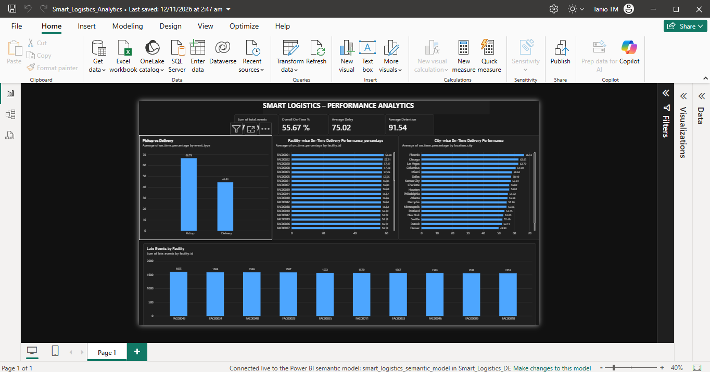

Smart Logistics Data Engineering & Real-Time Monitoring

An end-to-end data engineering and analytics project built using **Microsoft Fabric, PySpark, Delta Lake, and Power BI**.

The project processes logistics delivery and pickup events through a **Bronze → Silver → Gold** architecture and produces business-focused performance insights through an interactive Power BI dashboard.

📌 Project Overview

The goal of this project is to analyze logistics operations and identify:

- Delivery and pickup performance
- On-time vs late events
- Facility-level performance
- City-level performance
- Average delivery delays
- Average detention time
- Facilities with the highest number of late events

The project demonstrates an end-to-end data engineering workflow using Microsoft Fabric.

---
 🏗️ Architecture

text
Raw CSV Files
     │
     ▼
┌──────────────┐
│    BRONZE    │
│  Raw Files   │
└──────┬───────┘
       │
       ▼
┌──────────────┐
│    SILVER    │
│ Data Cleaning│
│ Validation   │
│ Transformation
└──────┬───────┘
       │
       ▼
┌─────────────────────────────┐
│            GOLD             │
│                             │
│ Delivery Performance        │
│ Facility Performance        │
│ Location Performance        │
└──────────────┬──────────────┘
               │
               ▼
        Power BI Semantic Model
               │
               ▼
        Power BI Dashboard

🛠️ Technologies Used
- Microsoft Fabric
- OneLake
- Lakehouse
- Delta Lake
- PySpark
- Python
- Power BI
- DAX
- SQL

📂 Microsoft Fabric Components
Workspace
Smart_Logistics_DE
Lakehouse
LH_SmartLogistics
Semantic Model
Smart_Logistics_Analytics

🥉 Bronze Layer
The raw logistics dataset was uploaded into the Fabric Lakehouse Files area.

The dataset contained:
- 14 CSV files
- 549,706 total rows
The raw data was retained as the source layer before transformation.

🥈 Silver Layer
The primary delivery event dataset was cleaned and transformed using PySpark.
Silver Table
silver_delivery_events
Records
170,820 events

Important columns
| Column | Description |
|---|---|
| `event_id` | Unique event identifier |
| `load_id` | Load identifier |
| `trip_id` | Trip identifier |
| `event_type` | Pickup or Delivery |
| `facility_id` | Facility identifier |
| `scheduled_datetime` | Scheduled event time |
| `actual_datetime` | Actual event time |
| `detention_minutes` | Detention duration |
| `on_time_flag` | On-time status |
| `location_city` | Event city |
| `location_state` | Event state |
| `delay_minutes` | Delay in minutes |

Data Quality Checks
The Silver layer was validated for:
- Duplicate event IDs
- NULL values in key columns
- Date/time consistency
- Delay calculations
- On-time classification

Result:

170,820 records successfully validated with no duplicate event IDs and no NULL values in the key columns.

🥇 Gold Layer
Three analytical Gold tables were created.
1. Delivery Performance
gold_delivery_performance

Provides aggregated performance by event type.

Key metrics:
- Total events
- On-time events
- Late events
- Average delay
- Average detention
- On-time percentage
2. Facility Performance
gold_facility_performance

Provides performance metrics for individual facilities.

Contains 50 facilities.
3. Location Performance
gold_location_performance

Provides performance metrics by:
- City
- State
Contains 20 locations.

📊 Key Results
Overall Performance
| KPI | Result |
|---|---:|
| Total Events | **170,820** |
| Overall On-Time % | **55.67%** |
| Average Delay | **75.02 min** |
| Average Detention | **91.54 min** |

Pickup vs Delivery
| Event Type | On-Time % |
|---|---:|
| Pickup | **66.73%** |
| Delivery | **44.61%** |
The analysis shows that pickup events performed better than delivery events in terms of on-time performance.

📈 Power BI Dashboard

The Power BI dashboard contains:
- Total Events KPI
- Overall On-Time Percentage
- Average Delay
- Average Detention
- Pickup vs Delivery On-Time Performance
- Facility-wise On-Time Performance
- City-wise On-Time Performance
- Top 10 Facilities by Late Events
The dashboard was built using a Direct Lake semantic model connected to the Fabric Lakehouse.
🔍 Data Quality & Validation
The Gold layer was validated against the Silver layer.

Validation included:
- Total row reconciliation
- Event count validation
- On-time + late event validation
- Percentage calculation validation
- NULL validation
- Duplicate validation
All core Gold-table validation checks passed.

💡 Business Insights
The project can help logistics teams:
- Identify facilities with poor on-time performance
- Compare pickup and delivery efficiency
- Identify locations experiencing frequent delays
- Monitor detention time
- Prioritize facilities requiring operational improvement
- Track logistics performance through an interactive dashboard
🚀 Skills Demonstrated
Data Engineering
- ETL / ELT
- Data ingestion
- Data cleaning
- Data transformation
- Data validation
- Medallion architecture
- Delta Lake
- Lakehouse architecture
Programming
- Python
- PySpark
- SQL
Analytics
- Data aggregation
- KPI development
- Performance analysis
- DAX measures
- Power BI visualization
Microsoft Fabric
- Fabric Lakehouse
- OneLake
- Notebooks
- Delta tables
- Direct Lake
- Semantic models
- Power BI

Smart-Logistics-Data-Engineering/
│
├── README.md
│
├── notebooks/
│   └── Smart_Logistics_Silver_Gold.ipynb
│
├── powerbi/
│   └── Smart_Logistics_Analytics.pbix
│
├── screenshots/
│   └── dashboard.png
│
└── data/
    └── README.md

🎯 Project Objective
This project demonstrates how raw logistics data can be transformed into validated analytical datasets and business insights using a modern cloud data platform.

Bronze → Silver → Gold → Semantic Model → Power BI Dashboard

👨‍💻 Author
Tanio TM
B.E. Computer Science & Engineering
Aspiring Data Engineer
Skills
Microsoft Fabric · PySpark · Python · SQL · Power BI · Data Engineering.
